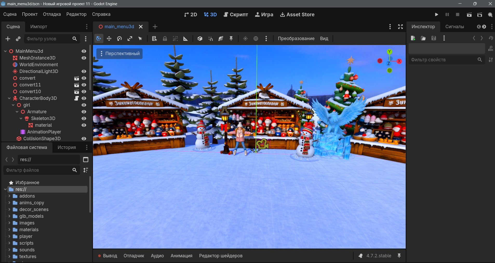
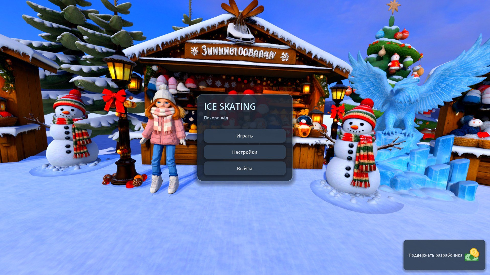
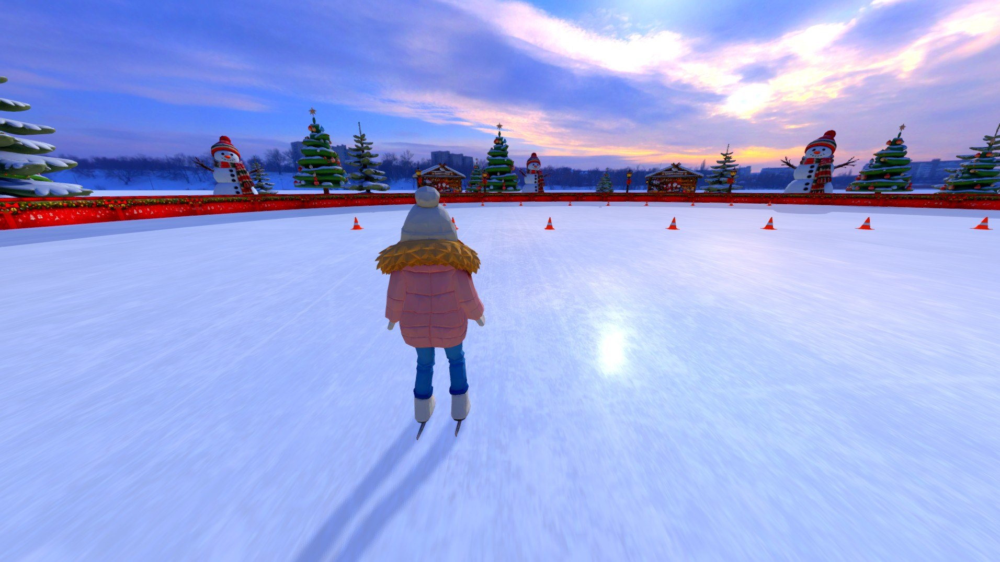
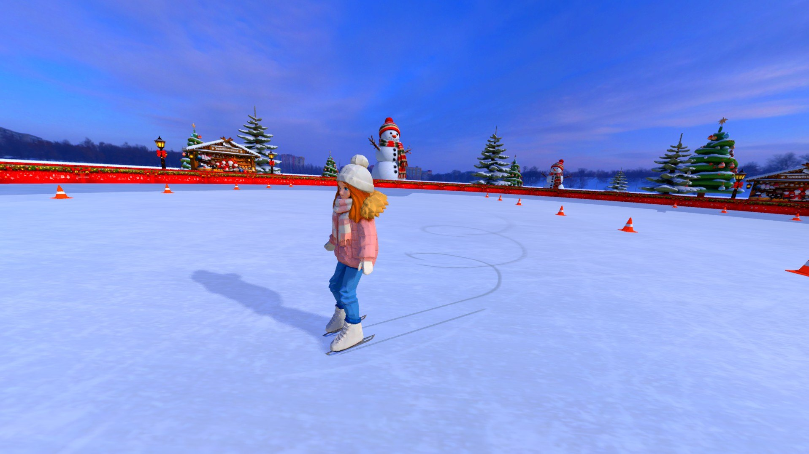

## Ice Skating

# Itch - https://yaley.itch.io/ice-skating

Step onto the ice and leave the world behind.

This is a peaceful ice-skating experience designed for relaxation and immersion.

There are no objectives to complete, no scores to chase, and no timers counting down. Instead, you are free to skate at your own pace, exploring beautifully crafted winter locations filled with atmosphere and quiet charm. Glide across frozen lakes, wander through serene snowy landscapes, and take in the stillness around you.

Feel the smooth rhythm of movement as your blades trace lines across the ice. Listen to the subtle sounds of skating and the calm ambience of the environment. Every location invites you to slow down, breathe, and simply exist in the moment.

This is not a game about winning.
It’s a game about freedom, space, and the simple joy of movement.